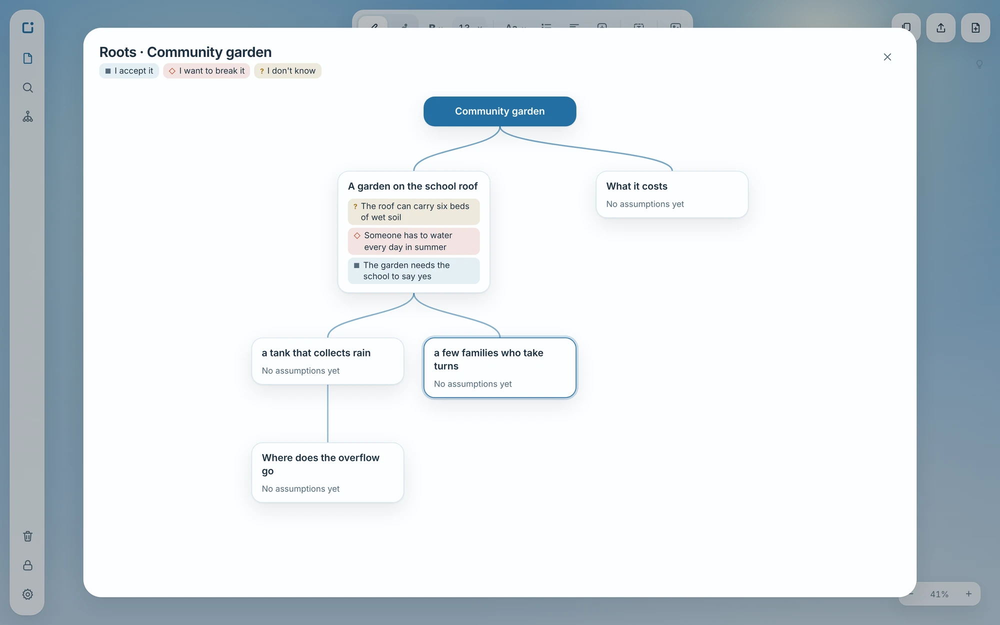
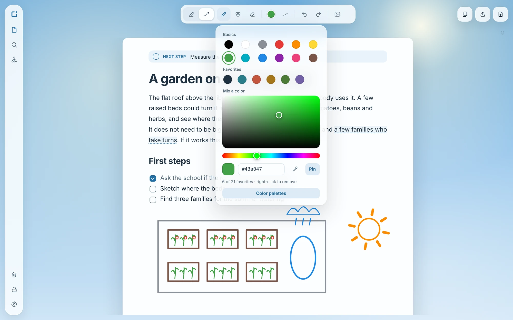

# OuraBox

**Out of the Box.**

**A safe space to develop genuine ideas.**

> *"Hay gente que juega mejor que el Bayern y no tiene para comer."*
> *(There are people who play better than Bayern and don't have enough to eat.)*

The world is cruel and people are born naive. OuraBox is the portal that carries naivety into the real world without the clash of worlds: a space for ideas, quick or deep, from any field, where what matters is not who you are or what degrees you hold, but what you bring and what you work on.

It's for people with ideas and callings outside their official lane: the lawyer who always wanted to be an architect, the programmer who always wanted to be a musician, the talent with few resources that nobody sees.

OuraBox doesn't inflate egos or put anyone in the box. It is cold but warm: it helps you see the assumptions that limit each idea and hands the question back to the person who thinks differently. It is minimalist and calm, and it doesn't charge its users.

| | |
|---|---|
|  |  |
| **About this idea:** one next step, and the assumptions you take for granted. | **Roots:** go deeper from any sentence, and see how an idea grew. |
|  |  |
| **Drawing:** pen, blends, eraser, shapes and your own colors. | **Side by side,** here under the night sky. |

*Screenshots of the app as it is today (beta), with example content.*

## What exists today

- **A desktop app in beta**, in [`app/`](app/) (version 0.1.0): projects, files and quick notes; writing, drawing and images on the same page; a place in each idea to write down its assumptions. [What it does](app/README.md#what-it-does-today).
- **Windows** is the system it's built and tried on. An installer is built automatically on each change (the repository's Actions tab, under Artifacts); it isn't signed and doesn't update itself. Linux and macOS aren't tried yet: Tauri builds for them, but nobody has checked OuraBox there.
- **Everything stays on your computer, encrypted with your password.** There is no server, no online account and no sync between devices.
- **Not there:** no mobile app, no AI, no community and no companies. Those are ideas for later, described below, and may never be built.

[What beta means](docs/08-plan.md#what-beta-means).

## Security, in short

Documents, drawings, images and titles are encrypted on disk (Argon2id and XChaCha20-Poly1305, with established libraries). That protects them from someone who gets the files or an encrypted backup without the password. It doesn't protect them from someone using the computer while the space is open, or from malware on the computer. Exports (PDF, image, text) leave unencrypted. **The encryption has not had an external review yet.** Details: [Technology](docs/07-technology.md#security) and [Security](SECURITY.md).

## The vision: three spaces

Only the first one exists, as the desktop app above. The other two are ideas, not plans with dates.

1. **Safe space:** your ideas, private by default. *(desktop app in beta)*
2. **Community:** people working on their ideas. *(idea, not built)*
3. **Companies:** open doors for talent, and perhaps what would keep OuraBox going. *(idea, not built)*

**[Read the documentation](docs/README.md)**

## Taking part

- **Trying it and saying what got in the way** is the most useful help right now: open an [issue](https://github.com/viraloyster/OuraBox/issues).
- **Code, texts or translations:** read [Contributing](CONTRIBUTING.md) first.
- **A security problem:** never in public; see [Security](SECURITY.md).
- Everyone in the project's spaces follows the [Code of conduct](CODE_OF_CONDUCT.md).

## License

Copyright (C) 2025-2026 viraloyster.

OuraBox's code is free under the [GNU AGPL, version 3](LICENSE) (`AGPL-3.0-only`): anyone can use it, study it, modify it and share it, as long as what they distribute, or what they offer to others over the internet, stays open under the same license. That way anyone can check that their ideas are safe, and nobody can take OuraBox and close it.

The license covers the code, not the OuraBox name or logo: a modified version has to carry a different name.

OuraBox builds on the work of others (typefaces, libraries): see [Third-party notices](THIRD_PARTY_NOTICES.md).
